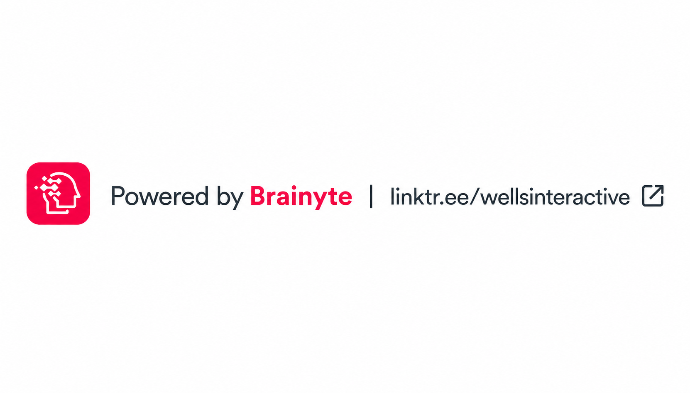

# 🍽️ Brainyte POS Mobile App

<p align="center">
  
</p>

<p align="center">
  <strong>One App. Every Restaurant Operation.</strong>
</p>

<p align="center">
  <strong>Modern • Fast • Mobile • Realtime • Restaurant Point of Sale</strong>
</p>

<p align="center">


</p>

---

## 📱 Overview

**Brainyte POS Mobile App** is a modern, mobile-first Restaurant Point of Sale and management application built with **Flutter** and powered by a **PHP REST API backend**.

It brings essential restaurant operations together in one mobile application, allowing different staff roles to work from the same system while maintaining role-specific dashboards and workflows.

From **waiters taking table orders**, to **kitchen and bar teams processing orders**, to **management monitoring sales**, and **delivery staff handling deliveries**, Brainyte POS provides a unified restaurant operation experience.

---

# 🚀 One App Does It All

Brainyte POS connects the restaurant's major operational areas in one application.

```text
                         🍽️ BRAINYTE POS
                              │
        ┌─────────────────────┼─────────────────────┐
        │                     │                     │
     👨‍🍳 Waiter             👨‍🍳 Kitchen           🍹 Bar
        │                     │                     │
     Tables                Food Orders          Drink Orders
     Orders                Preparing            Preparing
     Menu                  Ready                Ready
        │                     │                     │
        └─────────────────────┼─────────────────────┘
                              │
                       📦 Order System
                              │
              ┌───────────────┼───────────────┐
              │               │               │
           👑 Admin        📊 Manager       🏢 Owner
              │               │               │
           Reports          Monitoring       Overview
                              │
                        🚚 Delivery
                              │
                    Customer + Rider
```

Different restaurant roles can access the functions relevant to them while working from the same centralized system.

---

# ✨ Features

## 👨‍🍳 Waiter POS

The waiter module provides the complete workflow for taking and managing customer orders.

* 🔐 Email & Password-based login
* 🍽️ Restaurant table management
* 🪑 Table availability and occupancy status
* ➕ Create customer orders
* 🍔 Add food items
* 🥤 Add drink items
* 🔎 Search menu items
* 🛒 Cart-based ordering
* 📝 Add order instructions
* 📤 Submit orders to the restaurant system
* 🔄 Track order status
* 📋 View active orders
* 💰 Open and close customer tables
* 💵 Automatic order total calculation
* 🚪 Secure logout

---

## 🍳 Kitchen Module

The Kitchen Dashboard provides a dedicated workflow for food preparation.

* 📡 Receive food orders
* ⏳ Pending orders
* 👨‍🍳 Preparing orders
* ✅ Ready orders
* 🍽️ Served orders
* ✔️ Complete orders
* 🔄 Update individual item status
* ⚡ Live order synchronization
* 📋 Order and item details
* ⏱️ Preparation workflow

---

## 🍹 Bar Module

The Bar Dashboard provides the same streamlined workflow for beverage orders.

* 📡 Receive drink orders
* ⏳ Pending
* 🍸 Preparing
* ✅ Ready
* 🍽️ Served
* ✔️ Completed
* 🔄 Update drink order status
* ⚡ Live synchronization
* 📋 View order and item information

---

## 👑 Admin Dashboard

Administrators can monitor restaurant activity from a centralized dashboard.

* 📊 Restaurant overview
* 💰 Today's revenue
* 🧾 Orders today
* 🪑 Occupied tables
* 🪑 Available tables
* 📋 Recent orders
* 🍳 Kitchen queue monitoring
* 🍹 Bar queue monitoring
* 👥 Active waiter information
* 🔄 Refresh analytics
* 🔐 Secure logout

---

## 📊 Manager Dashboard

Management users have access to restaurant operational information and monitoring tools through a dedicated dashboard.

* 📊 Operational overview
* 📋 Order monitoring
* 🪑 Table activity
* 📈 Restaurant activity
* 🔄 Backend data synchronization
* 🔐 Role-based access

---

## 🏢 Owner Dashboard

Owners have access to the owner-level restaurant overview and operational information.

* 📊 Business overview
* 💰 Revenue information
* 🧾 Order activity
* 🪑 Table activity
* 📈 Restaurant monitoring
* 🔐 Owner-level access

---

## 🛡️ Supervisor Dashboard

Supervisors can monitor restaurant operations through their dedicated role-based dashboard.

* 📊 Operational monitoring
* 🧾 Order activity
* 🪑 Table activity
* 👥 Staff-related operational visibility
* 🔄 Live backend synchronization

---

# 🚚 Delivery Management

Brainyte POS also includes a delivery workflow covering both customers and riders.

## 👤 Customer Delivery

Customers can:

* 🍽️ Browse available menu items
* ➕ Select items for delivery
* 🔢 Specify quantities
* 📍 Enter delivery address
* 📱 Submit delivery requests
* 📋 View delivery orders
* 🔄 Track delivery status

## 🛵 Rider Delivery

Riders can:

* 📋 View available deliveries
* 🤝 Accept delivery assignments
* 📍 View delivery location information
* 📡 Share their current location
* 🚚 Mark orders as **Out for Delivery**
* ✅ Mark deliveries as **Delivered**
* 📞 View customer contact information
* 📍 View delivery address

---

# 👥 Role-Based Access

Brainyte POS supports multiple operational roles from the same application.

| Role           | Access                          |
| -------------- | ------------------------------- |
| 👨‍🍳 Waiter   | Tables, menu, orders            |
| 🍳 Kitchen     | Food preparation queue          |
| 🍹 Bar         | Drink preparation queue         |
| 🛡️ Supervisor | Operational monitoring          |
| 📊 Manager     | Restaurant management           |
| 👑 Admin       | System monitoring and analytics |
| 🏢 Owner       | Business overview               |
| 👤 Customer    | Delivery ordering               |
| 🛵 Rider       | Delivery management             |

After authentication, the application automatically routes users to the dashboard associated with their role.

---

# ⚡ Live Order Updates

Brainyte POS is designed for fast restaurant communication.

The application supports **Server-Sent Events (SSE)** for live events with automatic polling fallback.


If the live event connection is unavailable, the application automatically falls back to periodic status polling.

---

# 🧾 Order Workflow

```text
🪑 Select Table
       ↓
🍔 Select Food / Drinks
       ↓
📝 Add Instructions
       ↓
🛒 Review Order
       ↓
📤 Submit Order
       ↓
🍳 Kitchen / 🍹 Bar
       ↓
⏳ Pending
       ↓
👨‍🍳 Preparing
       ↓
✅ Ready
       ↓
🍽️ Served
       ↓
✔️ Completed
       ↓
💰 Close Table
```

---

# 🖨️ Thermal Printing

The application is designed for restaurant POS workflows where printed order tickets and receipts can be integrated with thermal printing hardware.

> **Note:** Thermal printer integration is part of the POS workflow specification; printer-specific support depends on the printer protocol, Android connectivity method, and the implementation enabled in the deployed build.

Potential restaurant printer workflows include:

* 🧾 Customer receipts
* 🍳 Kitchen tickets
* 🍹 Bar tickets
* 📄 58mm thermal paper
* 📄 80mm thermal paper
* 📱 Bluetooth printer integration
* 🌐 Network printer integration

---

# 🏗️ Technology Stack

| Technology             | Version / Role                 |
| ---------------------- | ------------------------------ |
| Flutter                | 3.44.3                         |
| Dart                   | 3.12.2                         |
| PHP                    | 8.x                            |
| Riverpod               | 3.x                            |
| Dio                    | REST API communication         |
| Flutter Secure Storage | Secure local credentials       |
| Shared Preferences     | Local application/session data |
| Flutter Map            | Map and location features      |
| Geolocator             | Rider location services        |
| Material Design        | Material 3                     |

---

# 🔌 Backend Architecture

Brainyte POS communicates with a PHP backend through REST APIs.

---

# 🎨 UI Highlights

* 🎨 Material 3 Design
* 📱 Mobile-first interface
* 🌙 Dark-mode-ready styling
* ⚡ Fast navigation
* 📐 Responsive layouts
* 🧩 Reusable components
* 🗂️ Clean card-based interfaces
* 🔄 Live status indicators
* 📊 Dashboard statistics
* 🔔 Friendly status and error feedback
* 🧭 Role-specific navigation

---

# 📸 Screens & Workspaces

* 🔐 Login
* 🍽️ Waiter View
* 🪑 Tables
* 📝 Create Order
* 🛒 Order Cart
* 📋 Active Orders
* 🍳 Kitchen Queue
* 🍹 Bar Queue
* 🚚 Customer Delivery
* 🛵 Rider Deliveries
* 📊 Admin Monitoring
* 📈 Manager Dashboard
* 🏢 Owner Dashboard
* 🛡️ Supervisor Dashboard

---

# 🔐 Security

Brainyte POS uses a role-based authentication workflow with backend API authentication.

Security-related components include:

* 🔐 Email and password authentication
* 🎫 Bearer token-based API authentication
* 🔄 Token refresh support
* 🚪 Token/session revocation
* 🔒 Secure local credential storage
* 👥 Role-based dashboard routing
* 🧹 Session clearing on logout

---

# 🚀 Installation & Development

### Requirements

* Flutter 3.44.3
* Dart 3.12.2
* Android SDK
* PHP 8.x backend
* Configured Brainyte POS API


---

# 📦 Android Download

## 📱 Download Brainyte POS Mobile

Get the latest Android version of Brainyte POS Mobile.

<p align="center">
  <a href="https://github.com/Wells-Interactive/brainyte-pos-mobile/releases/latest">
    
  </a>
</p>

> **Android:** Download the latest APK from the official GitHub Releases page and install it on your device.

### Installation

1. Click **Download APK** above.
2. Download the latest `.apk` file.
3. Open the downloaded APK on your Android device.
4. If Android displays **“For your security, your phone currently isn’t allowed to install unknown apps from this source”**, tap **Settings**.
5. Enable **Allow from this source** for the browser or file manager used to open the APK.
6. Go back and tap **Install**.
7. Once installation is complete, launch **Brainyte POS**.

> ⚠️ **Security Note:** After installing Brainyte POS, you can disable **Allow from this source** again in Android settings. Only install APK files downloaded from the official Wells Interactive GitHub repository.

---

# 🛣️ Roadmap

Future enhancements can include:

* 🖨️ Expanded thermal printer support
* 🧾 Advanced receipt templates
* 💳 Paystack & Paypal Payment integration
* 📊 Advanced analytics
* 📈 Business reports
* 👥 Staff management
* 🏪 Multi-branch restaurant support
* 📱 Offline-first operation
* 🔔 Push notifications
* 🧾 Tax and discount management
* 📦 Stock tracking
* 🔄 Advanced order synchronization

---

# 🤝 Contributing

Contributions, ideas, bug reports, and feature requests are welcome.

Please open an issue or submit a pull request with a clear description of the proposed change.

---

# 📄 License

Copyright © 2026 **Wells Interactive Services Ltd.**

All Rights Reserved.

---

<p align="center">

### 🍽️ Brainyte POS Mobile App

**One App. Every Restaurant Operation.**

**Built with ❤️ using Flutter, Riverpod & PHP Backend**

**Developed by Brainyte for Wells Interactive Services Ltd.**

### 🌐 Wells Interactive

[Website](http://www.wellsint.site)

### 🧠 Brainyte

[Brainyte](http://www.wellsint.site/brainyte)

</p>

